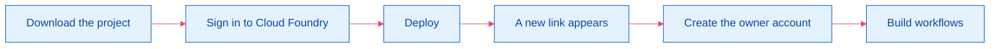
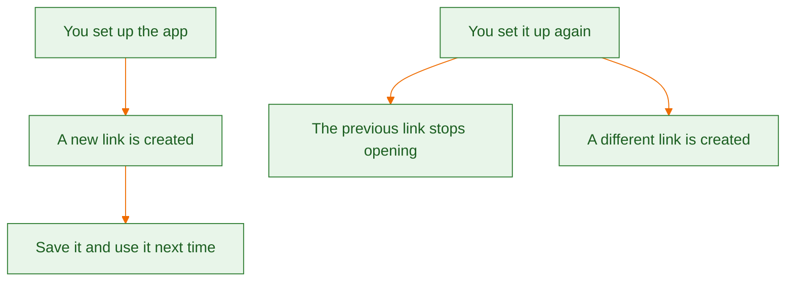

<p align="center">
  
  
  
</p>

<h1 align="center">n8n on SAP BTP</h1>

<p align="center">
  <b>Build workflows in the browser.</b><br>
  Every setup mints a brand-new link. Save it. That link is the door.
</p>

<p align="center">
  
  
  
  
</p>



<p align="center">
  <a href="#before-you-start"></a>
  <a href="#set-it-up"></a>
  <a href="#your-link"></a>
  <a href="#first-visit"></a>
  <a href="#keep-in-mind"></a>
</p>

---

## Before you start

Three tools, then one address from SAP BTP.

| | Get this | It is used to |
| :---: | --- | --- |
|  | [Git](https://git-scm.com/downloads) | Download this project |
|  | [Node.js 22](https://nodejs.org/) | Run the setup command |
|  | [Cloud Foundry CLI](https://docs.cloudfoundry.org/cf-cli/install-go-cli.html) | Send the app to SAP BTP |

> [!TIP]
> In the SAP BTP cockpit, open your subaccount and copy the **API endpoint**. It looks like `https://api.cf.us10-001.hana.ondemand.com`.

## Set it up

Open a terminal. Run the steps from top to bottom.

### 

```bash
git clone https://github.com/Kalpa-Ranjan/n8n-in-cf.git
cd n8n-in-cf
```

### 

```bash
cf login -a https://api.cf.us10-001.hana.ondemand.com --sso
```

Use your own API endpoint if it is different.

1. The command prints a web address. Open it.
2. Sign in and copy the temporary code.
3. Paste the code into the terminal.
4. Choose your org and space.

### 

```bash
npm run deploy
```

When it finishes, the last lines are your door:

```text
Your link:
https://my-n8n-platform-a1b2c3.cfapps.us10-001.hana.ondemand.com
```

<p align="center">
  
  
  
</p>

<p align="center"><sub>App name · fresh code, different every setup · shared SAP address</sub></p>

> [!IMPORTANT]
> Save the whole link. The green code changes on the next setup, and the old link stops opening.

## Your link



| Moment | What you do |
| --- | --- |
|  | Copy the new link from the terminal |
|  | Open that same link |
|  | Use the new link. Leave the old one behind |

## First visit

<p align="center">
  
  
  
</p>

Use your email and a password you will remember. The next visit is the same link, then that email and password.

## Keep in mind

| Topic | What it means |
| --- | --- |
|  | Workflows and saved passwords stay only while this setup is running |
|  | Clears that work and gives you a different link |
|  | Clears that work too. Create it again afterward |
|  | Anyone who has it can open the page. Share it only with people who should use it |
|  | Their setup gets its own link. Yours does not open their app |

> [!WARNING]
> A new setup, or a restart, clears your workflows and saved passwords.
